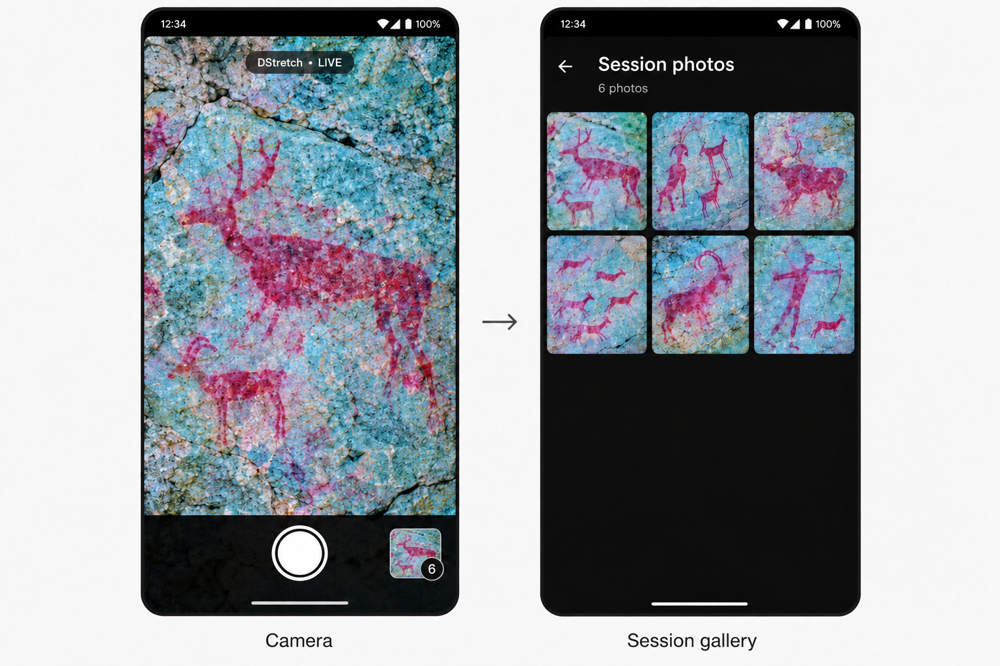
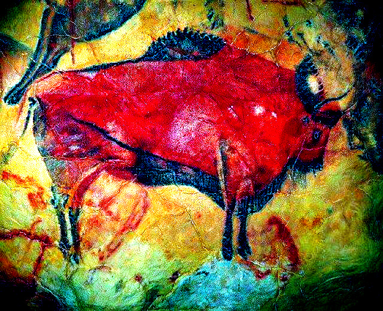

# DStretch


**Reveal subtle color differences — on your phone or from the command line.**

DStretch is an RGB decorrelation-stretch implementation in C++ with a native
Android camera app. The live viewfinder and captured photos run through the same
processing core as the desktop tool.

Built with **C++17 · Kotlin · Jetpack Compose · CameraX · Android NDK**.

## What you can do

- See DStretch applied live through the rear camera.
- Tap a point in the preview to focus and meter exposure.
- Capture a processed still photo at a higher resolution than the live preview.
- Browse the current session in a three-column gallery and open photos full screen.
- Turn the phone while the shutter and thumbnail stay fixed in the portrait interface.
- Process PPM images on the desktop with an adjustable stretch strength.

Processing happens on the device. The Android app requests only camera permission;
photos stay in app-private storage. The interface is in English.

<details>
<summary><strong>Camera and session gallery — design reference</strong></summary>



This is the original UI design reference, not a screenshot of a running build.

</details>

## Android quick start

Open [`android/`](android/) in Android Studio, select a **JDK 17 or 21** for
Gradle, install the SDK components below, and run the `app` configuration.
Keep the full repository together: the Android build references the C++ sources
in its parent directory.

| Requirement | Version |
| --- | --- |
| Device | Android 8.0 / API 26 or newer, rear camera |
| Native architectures | `arm64-v8a`, `x86_64` |
| JDK | 17 or 21 |
| Android SDK / Build Tools | 35 / 35.0.0 |
| Android NDK | 27.2.12479018 |
| SDK CMake | 3.22.1 |
| Gradle / Android Gradle Plugin | 8.11.1 / 8.9.2 |
| Kotlin / Compose compiler | 2.1.20 |

### Build from a terminal

Set `JAVA_HOME` to your JDK and `ANDROID_HOME` to your Android SDK. Put
`sdkmanager` and `adb` on your `PATH`, then run these commands from the repository
root:

```sh
sdkmanager --licenses
sdkmanager "platform-tools" "platforms;android-35" "build-tools;35.0.0" \
  "ndk;27.2.12479018" "cmake;3.22.1"

./android/gradlew -p android :app:assembleDebug
```

The installable APK is generated at:

```text
android/app/build/outputs/apk/debug/app-debug.apk
```

Connect an Android device with USB debugging enabled, then install and launch:

```sh
adb install -r android/app/build/outputs/apk/debug/app-debug.apk
adb shell am start -n org.dstretch.android/.MainActivity
```

Alternatively, copy the APK to your phone and open it there. On first launch,
grant camera permission. Tap the white shutter to capture a photo, and tap the
bottom-right thumbnail to open the session gallery.

The thumbnail and capture count update only after processing succeeds. A session
survives temporary backgrounding and Activity recreation. A new app process starts
with an empty gallery; previous files stay private and are not loaded into it.

See the [Android guide](android/README.md) for the processing pipeline, storage,
focus behavior, orientation handling, and performance notes.

## Desktop quick start

The command-line tool needs a C++17 compiler and Make. It has no external
image-processing dependencies.

```sh
make
./dstrech input.ppm output.ppm
```

The optional third argument scales the stretch strength:

```sh
./dstrech input.ppm output.ppm 1.5
```

The default is `1.0`. Both input and output retain the same image dimensions.
Input is binary PPM (`P6`), with 8-bit or 16-bit samples; 16-bit input is reduced
to 8 bits using each sample's high byte. Output is always 8-bit RGB PPM.

### JPEG example

With ImageMagick installed, try the supplied Altamira image:

```sh
mkdir -p build-desktop
magick docs/images/altamira.jpg -depth 8 build-desktop/input.ppm
./dstrech build-desktop/input.ppm build-desktop/output.ppm
magick build-desktop/output.ppm build-desktop/output.jpg
```

For ImageMagick 6, use `convert` in place of `magick`. ImageMagick is only needed
for format conversion, not for the stretch algorithm itself.

## Example

The supplied Altamira image, processed by the C++ core at strength `1.0`:

<table>
  <tr><th>Original</th><th>DStretch</th></tr>
  <tr>
    <td></td>
    <td></td>
  </tr>
</table>

## How the effect works

The core measures the image's mean RGB color and its 3×3 covariance matrix,
then finds the principal color axes using a cyclic Jacobi eigen-decomposition.
It amplifies deviations along those axes, reconstructs RGB, and clamps and rounds
each output channel to 0–255:

```text
output = mean + V · diag(gains) · Vᵀ · (input − mean)
```

At strength `1.0`, the axis with the largest variance gets a gain of **2.4**,
and the other two get **5.0**. Near-zero-variance secondary axes are left at a
gain of `1.0` to avoid amplifying numerical noise. This is an RGB-based effect;
the Android app calls the actual C++ implementation at the default strength.

Statistics are estimated separately for every image. Changes in the scene,
exposure, or white balance can therefore cause temporal color changes in the
live preview. No temporal smoothing is applied.

## Repository layout

```text
.
├── dstrech.cpp / dstrech.hpp   Shared C++ processing core and declarations
├── helpers.cpp / main.cpp     PPM I/O and desktop command-line entry point
├── Makefile                   Desktop build
├── android/                   Kotlin/Compose app, JNI bridge, Gradle wrapper
│   ├── app/src/main/          Camera, UI, resources, and Android native build
│   ├── app/src/test/          Host JVM tests for preview/focus geometry
│   ├── app/src/androidTest/   Device tests for JNI, capture, and gallery flows
│   ├── README.md              Android engineering and build guide
│   └── VALIDATION.md          Recorded checks and remaining device validation
├── native/                    Platform-independent RGBA adapter and host tests
└── docs/images/               Original icon artwork and UI design reference
```

The processing core and RGBA adapter contain no Android dependencies. Camera
formats, lifecycle, bitmap ownership, focus controls, and private storage belong
to the Android layer. APKs, local SDK settings, signing files, and generated build
outputs are excluded from Git. The Gradle wrapper, including its JAR, is tracked.

## Validation

### Native core and desktop parity

Requires CMake, a C++17 compiler, Python 3.9 or newer, and Ninja for this command:

```sh
cmake -S native -B build-native -G Ninja \
  -DCMAKE_BUILD_TYPE=RelWithDebInfo -DSANITIZE=ON
cmake --build build-native
ctest --test-dir build-native --output-on-failure
```

On supported host compilers, `SANITIZE=ON` enables AddressSanitizer and
UndefinedBehaviorSanitizer. Use `-DSANITIZE=OFF` for a toolchain without them.
Tests cover desktop/adapter parity, padded row and pixel strides, all four
right-angle rotations, in-place processing, and invalid buffers.

The recorded host comparisons were byte-exact. Android golden comparisons allow
one channel level (`1/255`) for cross-architecture floating-point rounding;
JPEG encoding is lossy and is tested separately.

### Android build and focus geometry

```sh
./android/gradlew -p android :app:assembleDebug :app:lintDebug \
  :app:testDebugUnitTest :app:assembleDebugAndroidTest
```

### Connected-device tests

With a rear-camera device or suitable emulator connected:

```sh
./android/gradlew -p android :app:connectedDebugAndroidTest
```

Device tests cover the JNI boundary, EXIF orientation, successful/failed file
processing, and capture-to-gallery navigation. Compiling the test APK does not
execute those tests. Physical autofocus, rotation, sustained frame rate, and
memory behavior still need device checks; see the
[validation record](android/VALIDATION.md).

## Current scope

The live preview targets 640×480 and processes at most 10 frames per second.
Still capture targets 1600×1200, with device-dependent resolution fallback.
Unexpected captures above six megapixels are rejected before decoding to bound
memory, and their originals are retained.

The screen preview uses center cropping, while photos retain the complete selected
frame. The gallery contains the current session only. Public photo export,
previous-session browsing, and automatic file deletion are outside the current
scope.
